# Cloudflare Buckets

> Console web para explorar, editar e administrar buckets Cloudflare R2 em três modos de execução: sandbox em memória, pasta local persistente e conexão real com Cloudflare.

O Cloudflare Buckets combina uma interface React com um gateway Express e um motor de armazenamento unificado. A mesma experiência pode ser usada sem credenciais para demonstração, com uma pasta do sistema para persistência local ou com credenciais R2 para operar uma conta real.

## Índice

- [[#visao-geral]]
- [[#arquitetura]]
- [[#modos-de-conexao]]
- [[#funcionalidades]]
- [[#fluxos-principais]]
- [[#endpoints-da-api]]
- [[#estrutura-do-projeto]]
- [[#tecnologias]]
- [[#configuracao]]
- [[#execucao]]
- [[#testes-e-validacao]]
- [[#observabilidade]]
- [[#monorepo-exportavel]]
- [[#seguranca-e-limitacoes]]

## Visão geral

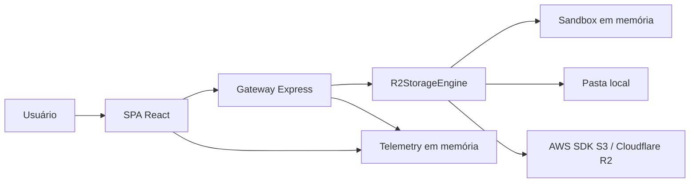

A interface é organizada em sete áreas:

1. **Buckets** — navegação hierárquica, upload, criação e exclusão.
2. **Editor** — edição de objetos de texto, highlighting, preview e salvamento automático.
3. **Busca global** — filtros por bucket, nome, chave e metadados.
4. **Telemetria** — métricas, custos estimados, logs e destinos de observabilidade.
5. **Expo Simulator** — prévia responsiva do fluxo de buckets em Android, iOS, Web, Windows e Linux.
6. **Wrangler Studio** — geração visual de `wrangler.toml`.
7. **Monorepo Explorer** — navegação e exportação em ZIP dos modelos gerados.

## Arquitetura

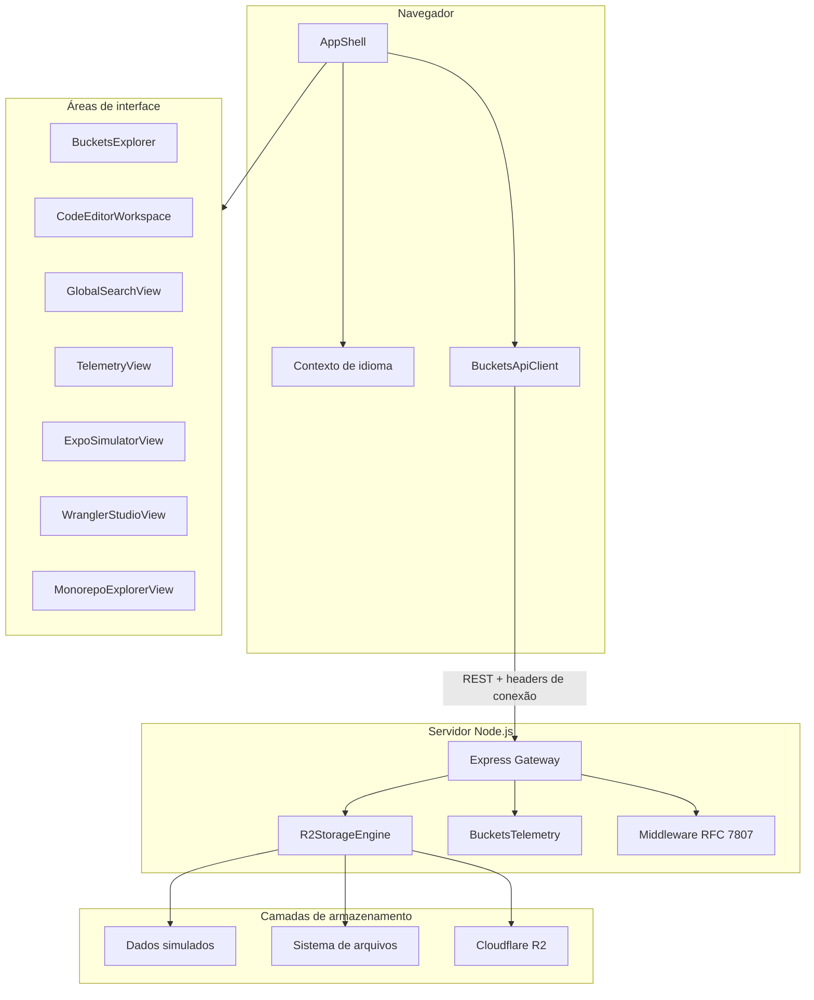

### Responsabilidades

| Camada | Responsabilidade |
|---|---|
| `manager/App.tsx` | Estado global da sessão, navegação, tema, idioma e conexão ativa |
| `manager/components/` | Telas, formulários, tabelas, editores e visualizações |
| `manager/services/apiClient.ts` | Chamadas REST e cabeçalhos da conexão selecionada |
| `manager/shared/` | Tipos, i18n, tratamento de erros e utilitários do editor |
| `server.ts` | Inicialização Express, rotas REST, upload multipart e middleware |
| `server/r2Engine.ts` | Implementação uniforme de sandbox, pasta local e Cloudflare R2 |
| `server/telemetry.ts` | Métricas, logs estruturados, custos e destinos de exportação |
| `server/errors.ts` | Erros tipados e respostas estruturadas |

## Modos de conexão

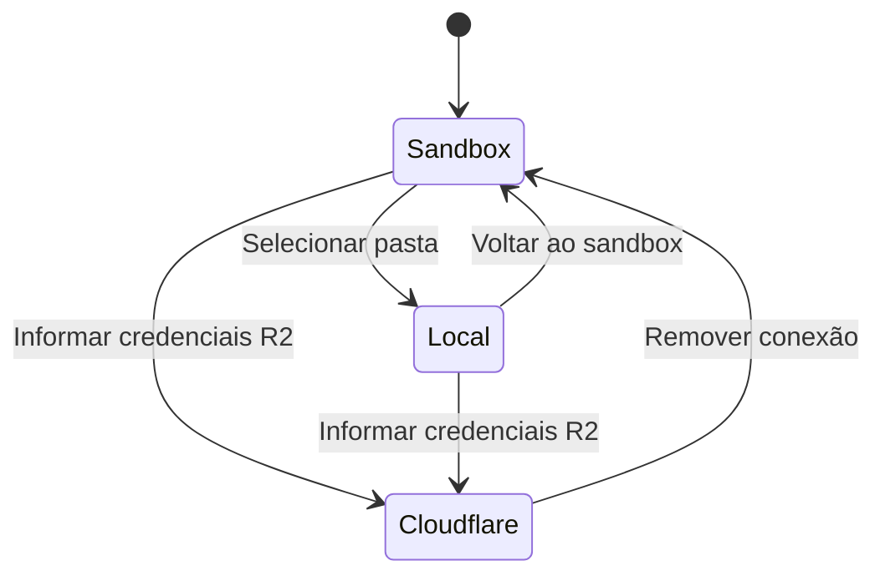

### Sandbox

Modo padrão e não persistente. Utiliza dados simulados iniciados pelo servidor e mantém buckets e objetos enquanto o processo permanece ativo.

### Pasta local

Persiste buckets como diretórios em uma pasta do host. A inspeção valida:

- Pasta vazia ou inexistente;
- Permissões de criação e escrita;
- Caminho absoluto normalizado;
- Restrição contra diretórios protegidos do sistema;
- Proteção contra travessia de caminho.

A pasta pode ser criada automaticamente quando configurada no painel de conexão.

### Cloudflare R2

Conecta ao R2 por meio do AWS SDK S3 compatível. A operação exige:

- Account ID;
- API token;
- R2 Access Key ID;
- R2 Secret Access Key.

As credenciais são enviadas pelo navegador aos cabeçalhos da requisição e não são persistidas pelo aplicativo web. Em uma implantação compartilhada, recomenda-se evitar o transporte direto de credenciais pelo navegador e usar um segredo ou token de sessão no gateway.

## Funcionalidades

### Gerenciamento de buckets

- Criar buckets;
- Escolher localização regional;
- Selecionar classe de armazenamento padrão ou de acesso pouco frequente;
- Listar quantidade de objetos e tamanho total;
- Excluir buckets vazios;
- Forçar exclusão de bucket após confirmação textual;
- Visualizar domínio público e estado de CORS disponíveis no modelo.

### Navegação e objetos

- Navegar por prefixes que representam diretórios virtuais;
- Criar pastas com ou sem objeto marcador;
- Fazer upload individual ou em lote;
- Arrastar arquivos diretamente para o explorador;
- Baixar objetos;
- Visualizar prévias textuais ou data URLs;
- Gerar URL pré-assinada com TTL configurável;
- Editar metadados;
- Excluir objetos ou pastas recursivamente;
- Mover objetos entre buckets e prefixes;
- Executar exclusões e movimentos em lote com relatório de sucesso e falha.

### Editor de código

- Detectar linguagem pela extensão;
- Editor com numeração de linhas;
- Highlighting com Prism;
- Alternar entre edição, divisão e prévia;
- Validar sinais básicos de sintaxe;
- Formatar conteúdo;
- Atualizar metadados;
- Abrir objetos existentes;
- Criar arquivos para extensões conhecidas;
- Salvamento manual;
- Salvamento automático após três segundos de espera.

### Busca global

A busca pode combinar:

- Texto no nome ou chave;
- Bucket específico;
- Chave de metadado;
- Valor de metadado;
- Tipo de conteúdo.

Os resultados informam o campo correspondente e permitem navegar diretamente para a pasta de origem.

### Telemetria

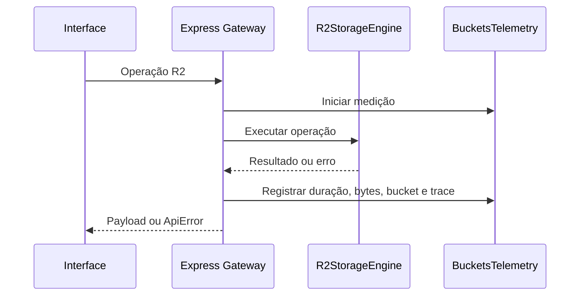

O painel fornece:

- Total de requisições;
- Tempo médio e percentil P95;
- Bytes transferidos;
- Taxa e quantidade de erros;
- Métricas por operação;
- Métricas por bucket;
- Estimativa de armazenamento e egress;
- Logs filtrados por nível, operação e texto;
- Exportação em JSON ou CSV;
- Configuração de sinks;
- Encaminhamento para destinos externos.

Sinks disponíveis no modelo:

- Rolling File;
- Application Insights;
- Seq;
- ELK Stack.

## Fluxos principais

### Upload

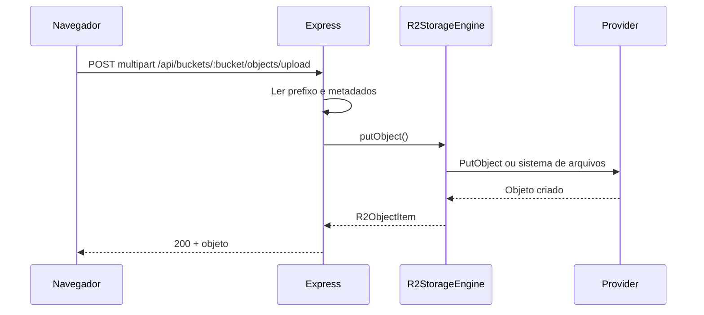

### Busca

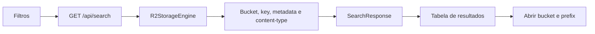

### Operação em lote

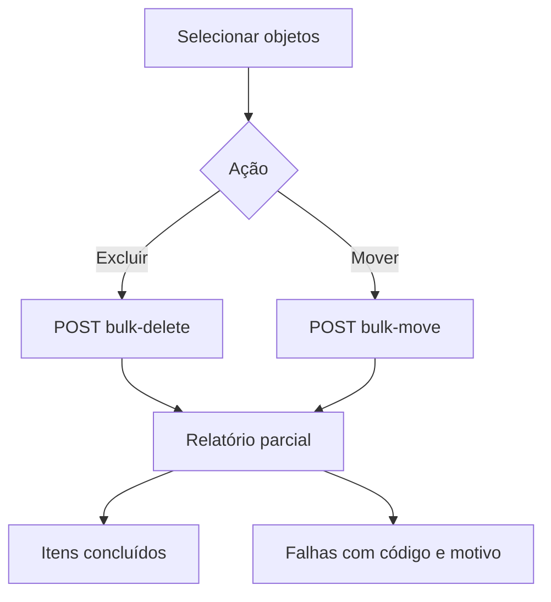

### Alteração de conexão

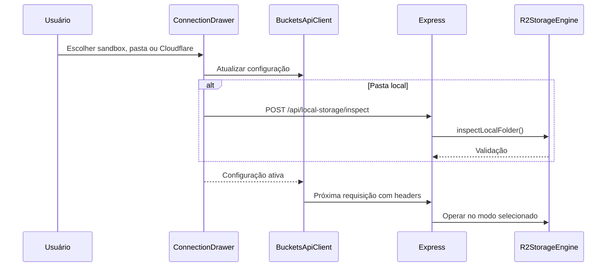

## Endpoints da API

| Método | Endpoint | Função |
|---|---|---|
| `GET` | `/api/health` | Status do servidor |
| `POST` | `/api/local-storage/inspect` | Validar/criar pasta local |
| `GET` | `/api/buckets` | Listar buckets |
| `POST` | `/api/buckets` | Criar bucket |
| `DELETE` | `/api/buckets/:bucket` | Excluir bucket |
| `GET` | `/api/buckets/:bucket/objects` | Listar diretório |
| `POST` | `/api/buckets/:bucket/folders` | Criar pasta virtual |
| `DELETE` | `/api/buckets/:bucket/folders` | Excluir pasta |
| `POST` | `/api/buckets/:bucket/objects/upload` | Upload multipart |
| `PUT` | `/api/buckets/:bucket/objects/content` | Criar ou salvar texto |
| `GET` | `/api/buckets/:bucket/objects/preview` | Pré-visualizar objeto |
| `GET` | `/api/buckets/:bucket/objects/download` | Baixar objeto |
| `POST` | `/api/buckets/:bucket/objects/presign` | Gerar URL pré-assinada |
| `GET` | `/api/search` | Busca global |
| `POST` | `/api/objects/bulk-delete` | Excluir vários objetos |
| `POST` | `/api/objects/bulk-move` | Mover vários objetos |
| `GET` | `/api/telemetry/metrics` | Métricas consolidadas |
| `GET` | `/api/telemetry/logs` | Consultar logs |
| `GET` | `/api/telemetry/logs/export` | Exportar logs |
| `POST` | `/api/telemetry/sinks` | Atualizar sink |

Cada operação instrumentada recebe um `X-Trace-Id`, gera `Server-Timing` e registra duração, bytes, bucket, objeto e possíveis erros.

## Estrutura do projeto

```text
.
├── server.ts                 # Inicialização Express e rotas REST
├── server/
│   ├── r2Engine.ts           # Sandbox, filesystem e Cloudflare R2
│   ├── telemetry.ts          # Métricas, logs e sinks
│   └── errors.ts             # Erros e resposta RFC 7807
├── manager/
│   ├── App.tsx               # Shell principal e navegação
│   ├── components/           # Componentes React das áreas do app
│   ├── services/apiClient.ts # Cliente HTTP tipado
│   ├── shared/               # Tipos, i18n, parsing e utilitários
│   └── monorepo/             # Catálogos e gerador de artefatos
├── tests/                    # Testes Node/TSX
├── vite.config.ts
├── tsconfig.json
├── package.json
└── .env.example
```

## Tecnologias

| Área | Tecnologia |
|---|---|
| Interface | React 19, React DOM |
| Construção | Vite 8 |
| Estilos | Tailwind CSS 4 |
| Servidor | Node.js, Express 4 |
| Linguagem | TypeScript |
| R2/S3 | AWS SDK for JavaScript v3 |
| Upload | Multer em memória |
| Ícones | Lucide React |
| Gráficos | Recharts |
| Editor | PrismJS |
| Arquivos ZIP | JSZip |
| Testes | Node test runner via `tsx` |

## Configuração

Copie o modelo de ambiente:

```bash
cp .env.example .env
```

Variáveis disponíveis:

```dotenv
PORT=3000
NODE_ENV=development
BUCKETS_LOCAL_FOLDER=
GEMINI_API_KEY=
```

- `PORT`: porta HTTP, padrão `3000`;
- `NODE_ENV`: em `production`, serve `distributions/`; nos demais modos, ativa o middleware Vite;
- `BUCKETS_LOCAL_FOLDER`: caminho padrão usado pelo modo pasta local;
- `GEMINI_API_KEY`: reservado ao uso de recursos server-side de IA.

No modo Cloudflare, as credenciais são informadas pela interface e encaminhadas em cada requisição.

## Execução

### Pré-requisitos

- Node.js compatível com os scripts do projeto;
- `npm`, `pnpm`, `yarn` ou `bun`;
- Permissão de escrita na pasta escolhida no modo local.

### Instalação e desenvolvimento

Com npm:

```bash
npm install
npm run dev
```

Com bun:

```bash
bun install
bun run dev
```

A aplicação ficará disponível em `http://localhost:3000`, salvo alteração da porta.

### Build de produção

```bash
npm run build
NODE_ENV=production npm start
```

O comando `build` gera a SPA em `distributions/`. `npm start` executa `server.ts` diretamente e, em produção, serve os arquivos estáticos.

### Outros scripts

| Comando | Uso |
|---|---|
| `npm run dev` | Servidor de desenvolvimento com Vite middleware |
| `npm start` | Inicializar o servidor |
| `npm run build` | Gerar build de produção |
| `npm run preview` | Pré-visualizar build pelo Vite |
| `npm run lint` | Verificação TypeScript sem emissão |
| `npm test` | Executar testes automatizados |
| `npm run clean` | Remover `build/`, `distributions/` e `server.js` |

## Testes e validação

A suíte cobre, entre outros pontos:

- Tratamento de erros no cliente;
- Utilitários do editor;
- Editor e highlighting;
- Telemetria e exportação;
- Internacionalização;
- Motor R2 em sandbox e nos modos disponíveis.

Execute:

```bash
npm test
npm run lint
npm run build
```

## Observabilidade

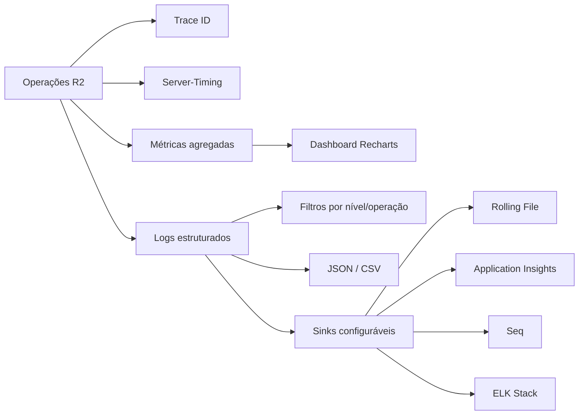

Os erros usam `AppApiError` com código estável, título, detalhe, status HTTP, trace ID e erros de validação opcionais. Isso permite apresentar mensagens amigáveis sem perder contexto técnico.

## Monorepo exportável

O aplicativo inclui uma área chamada **Monorepo**, que mostra e exporta modelos de:

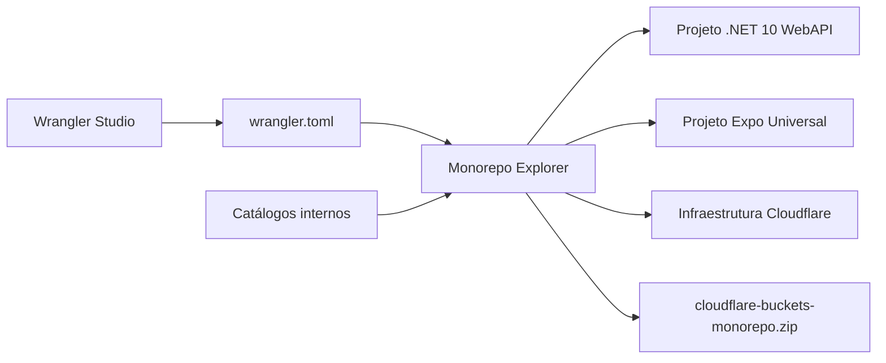

Os arquivos exportados são referências e esqueletos para uma arquitetura ampliada. O processo ativo desta aplicação usa Express e não inicia automaticamente os servidores ASP.NET Core ou Expo descritos no catálogo.

## Segurança e limitações

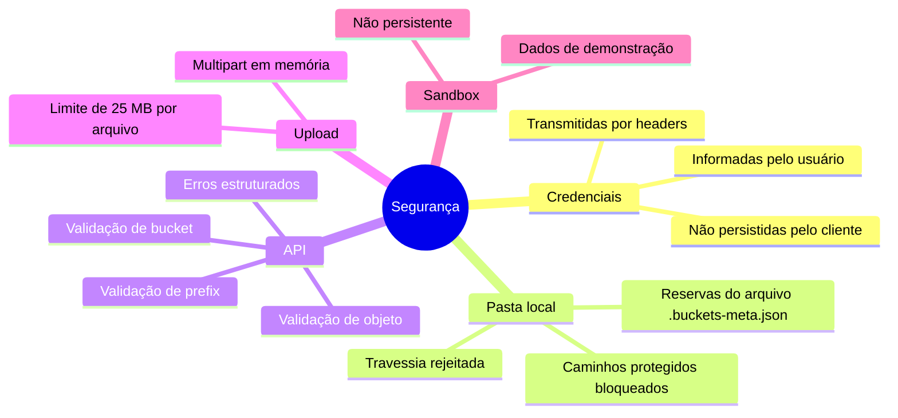

Pontos relevantes:

- O modo sandbox não representa dados reais;
- Upload multipart é limitado a 25 MB por arquivo;
- A API JSON aceita até 5 MB por requisição;
- Pastas locais não podem apontar para raízes protegidas;
- Keys reservadas e segmentos `.`/`..` são rejeitados;
- Exclusão recorrente pode exigir confirmação ou confirmação do nome do bucket;
- O telemetria atual é mantida em memória;
- As credenciais reais devem ser protegidas por um ambiente seguro em implantação compartilhada;
- O catálogo `.NET/Expo` é exportável e não substitui uma implantação desses runtimes.
